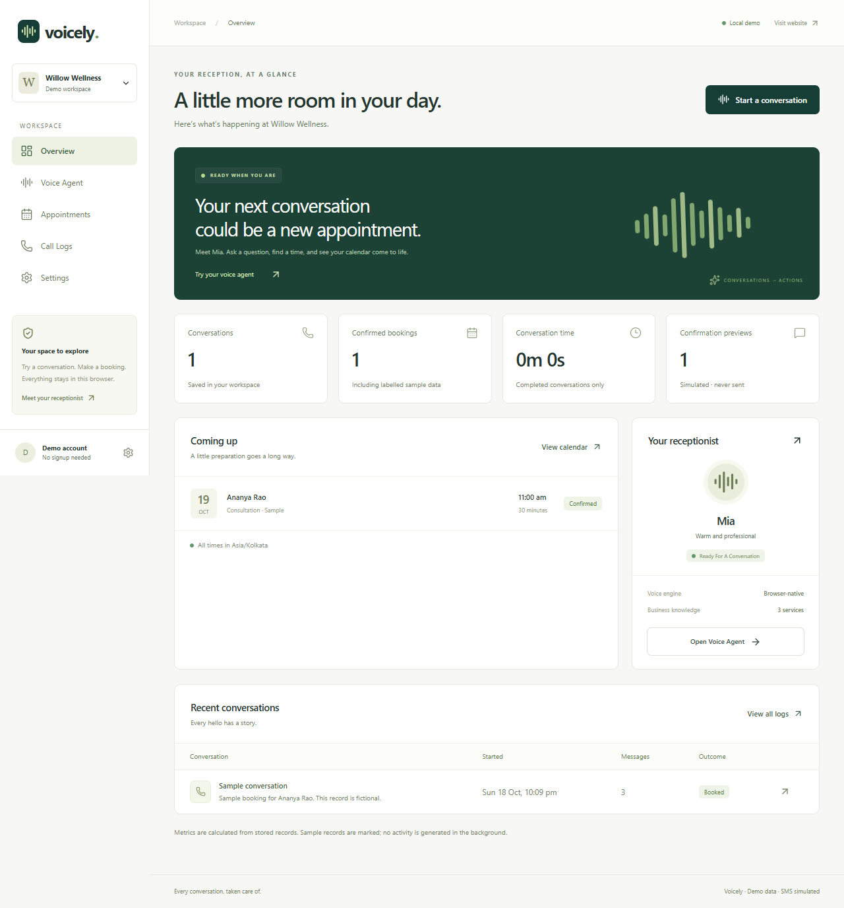
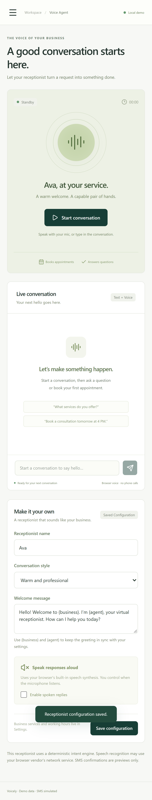

# Voicely

**Every conversation, taken care of.** A working receptionist SaaS MVP built with React, Vite, JavaScript/JSX, Tailwind CSS, Lucide, React Router, browser speech, persistent local Demo Mode, and an optional Supabase PostgreSQL backend.

The receptionist uses a deterministic intent/state engine. It is not a large language model. It converts supported customer requests into real persisted business actions. No API key, account, phone service, or paid subscription is required for the demo.

## Start locally

Requires Node.js **22.12 or newer** and npm. The delivered workspace already has dependencies installed.

```powershell
cd "C:\Users\Aadarsh Tiwari\Documents\Codex\2026-10-18\files-pasted-by-the-user-voicely\outputs\voicely"
npm.cmd ci
npm.cmd run dev
```

Open **http://127.0.0.1:5173**. Vite prints a different port if 5173 is occupied. `npm` also works in shells without the Windows PowerShell execution-policy restriction; `npm.cmd` avoids that restriction.

On Windows you can also double-click **`start-voicely.cmd`**. It installs missing dependencies and opens the application in your browser. Keep its terminal open while using the demo.

```powershell
npm.cmd test                 # Booking, dialogue, persistence, speech, PostgreSQL tests
npm.cmd run test:e2e         # Desktop and mobile browser journeys (local server required)
npm.cmd run build           # Production static bundle in dist/
npm.cmd run preview         # Serve production bundle, normally port 4173
npm.cmd run format          # Format JavaScript, JSX, CSS, JSON, and documentation
```

Browser tests use installed Google Chrome through Playwright's `chrome` channel. If Chrome is unavailable, install Chrome or change `channel` in `playwright.config.js` to `msedge` for installed Edge. Alternatively install Playwright Chromium (`npx.cmd playwright install chromium`) and remove `channel`. Mobile tests emulate an iPhone viewport in Chromium; they are not physical iOS/Safari tests.

## Professor demonstration

1. Open the landing page and choose **Try Live Demo**. No registration is required.
2. Open **Voice Agent**, then **Start conversation**.
3. Type `What services do you offer?`.
4. Type `I would like to book a consultation`.
5. Type `My name is Professor Taylor`.
6. Choose a future Monday–Saturday within 60 days. Type its ISO date and a time, for example `2026-10-21 at 2 PM`. If this example date has passed, replace it. All times use the displayed business timezone (initially Asia/Kolkata). Sunday is closed by default.
7. Inspect the proposed service, name, date, timezone, and duration. No booking exists yet. Type `confirm` or click **Confirm booking**.
8. Open **Appointments**, search for `Professor Taylor`, and select **Details**. Inspect the saved reference, status, recipient, SMS text, and **Simulated — Not Sent** label. **Copy message** copies the actual preview.
9. Switch to **Calendar** and find the same booking in its month.
10. Open **Call Logs**, search for `Professor Taylor`, and open **Transcript**. The actual messages and booking link appear.
11. Open **Overview**. Confirmed bookings and confirmation previews increased by one; all metrics use stored records, including labelled samples.
12. Return to the existing conversation. Request the same consultation at the same date and time using another name. Voicely rejects the conflict and offers up to three valid alternatives. Type an option number to propose one; confirmation is still required.
13. End the conversation. Open the first appointment and choose **Cancel appointment**. Confirm cancellation. It remains in history with a cancelled badge.
14. Start another conversation and request the original slot. It is available again. Confirm it if desired.
15. Refresh the page and inspect Appointments and Call Logs. Saved records remain.

Settings → **Reset Demo Data** asks for confirmation and resets only local Voicely demo records and business configuration. It does not modify cloud data or unrelated browser keys. End an active conversation first.

## Screens and features

- **Landing:** responsive product information, illustrative conversation, workflow explanation, workspace preview, working CTAs and anchor navigation. It makes no invented customer or performance claims.
- **Overview:** actual persisted conversation counts, confirmed booking counts, completed conversation duration, SMS preview counts, upcoming bookings, and recent call activity. Seed data is labelled.
- **Voice Agent:** start/end controls, elapsed timer, persisted transcript, typed input, microphone controls, listening/speaking indicators, saved receptionist name/style/greeting, optional spoken replies. Greeting tokens `{business}` and `{agent}` track configuration.
- **Appointments:** searchable status-filtered list, month calendar, details, manual booking with review before confirmation, cancellation with explicit confirmation, alternative slots, confirmation previews and copy.
- **Call Logs:** searchable actual transcripts, outcome filters, newest/oldest sorting, timestamps, durations, summaries, and originating appointment links.
- **Settings:** profile, address, phone, IANA timezone, editable services/prices/durations, daily opening hours, booking buffer, notice, advance-booking window, cancellation cutoff, local reset, and optional authenticated cloud connection.

## Architecture

```text
src/
  components/       Shared UI, application shell, appointment/SMS details
  pages/            Landing, Overview, Agent, Appointments, CallLogs, Settings
  state/            React application and conversation controller
  domain/
    booking.js      Pure booking validation, overlap, alternatives, cancellation
    conversation.js Stateful intent parser and dialogue transitions
    config.js       Business defaults, configuration validation, greeting tokens
    time.js         Temporal-based timezone and date utilities
  data/
    localRepository.js     Versioned, atomic local demo document
    supabaseRepository.js  Same repository contract backed by PostgreSQL RPCs
  services/
    speech.js       Recognition/synthesis lifecycle and duplicate protection
    integrations.js Explicit optional provider boundaries
supabase/migrations/       Database schema, constraints, RLS, booking RPCs
tests/                     Domain, storage, speech, SQL and browser tests
```

Both repositories implement `getSnapshot`, `saveConfig`, `startConversation`, `saveConversation`, `book`, `cancel`, and `reset` (cloud reset explicitly rejects). React never writes appointment data directly. The dialogue engine can be tested without React or a browser.

### Local persistence

`voicely.demo.v1` contains one versioned JSON document with configuration, appointments, conversations, and confirmations. A booking transaction updates its appointment, conversation relationship/outcome/summary, and simulated confirmation, then commits with one `localStorage.setItem`. A storage failure rejects the operation; the UI does not announce success.

The Web Locks API serializes mutations across tabs. Browsers without Web Locks fall back to a per-repository queue; use a single tab in those browsers. The storage event refreshes open tabs. Local storage is browser-local demo persistence, not a secure production database or a claim of distributed concurrency safety. Malformed stored data is backed up under a `.recovery.<timestamp>` key before reinitialization. Blocked/full storage produces an actionable error.

Cloud selection is remembered separately using `voicely.storage-mode`. Reconnection errors explicitly identify that Demo Mode is active; no failed cloud write is redirected to local storage. Switching mode is blocked while a conversation is active.

### Booking semantics

- One business calendar/resource; services define duration and display price in INR.
- Names are required; a customer phone is optional in this demo. Missing numbers are explicitly marked in SMS previews.
- All user-entered appointment dates/times are in the business timezone, independent of the browser timezone. Stored instants are UTC.
- Past, invalid, closed-day, out-of-hours, insufficient-notice, and too-far-ahead requests are rejected.
- Intervals are half-open: `[start, end)`. Existing and new appointments are separated by the larger of their original/current buffer. Zero-buffer back-to-back appointments are allowed.
- Cancelled bookings are excluded from conflicts but retain historical confirmations and call relationships. The cancellation cutoff is enforced.
- A stable idempotency key makes repeated confirmations return the existing booking without generating another SMS preview.
- The conversation must collect service, name, date, and time, validate availability, display a proposal, then receive explicit confirmation. It checks availability again at commit time.
- DST gaps and repeated local times are rejected rather than silently choosing an offset. Overnight opening-hour ranges are not supported; each open day must start before it ends.

### Conversation behavior

States are `idle`, `collect`, `confirm`, `cancel-identify`, `cancel-confirm`, and `ended`. The draft retains previously collected fields. Information questions do not discard a booking in progress. Supported dates include today/tomorrow, weekdays (next occurrence), named month dates, and ISO dates. Slashed numeric dates and vague times trigger clarification. Name phrases, names supplied at the expected step, service names, AM/PM, and 24-hour times are supported. Unknown requests explain the available actions.

For cancellation, supply an exact booking reference or matching full customer name, disambiguate multiple matches using a reference, and confirm. This is a receptionist demo identification workflow, not production customer identity verification.

The active in-memory dialogue is not restored after a full page refresh. Previously persisted messages/bookings remain in Call Logs; start a new conversation to continue. An interrupted conversation retains its last saved transcript and has no completed duration.

### Speech compatibility and privacy

Chrome/Edge commonly expose `SpeechRecognition` or `webkitSpeechRecognition`; actual availability depends on browser, OS, microphone permissions, network service, and secure origin. Localhost is permitted; deployed sites need HTTPS. Safari/Firefox support varies. Text always provides the complete booking flow.

No microphone starts on load or when starting a text conversation. Click the microphone to start a recognition turn. It stops after a final result. Permission/network/no-speech errors explain the text fallback. Recognition handlers are detached before synthesis starts so the assistant does not transcribe its own response. Result session identifiers and the application submission lock prevent duplicate speech events from producing repeated actions. End/disposal cancels synthesis and recognition. Spoken replies are opt-in and saved in agent settings. Browser recognition may send audio to the browser vendor; this application itself does not upload or retain audio.

## Optional Supabase setup

Demo Mode works without any environment file. To use a real database:

1. Create/select a Supabase project yourself. This application does not create external accounts or purchase resources.
2. Apply **`supabase/migrations/202610180001_voicely.sql`** to a fresh project using the Supabase SQL editor, or link a Supabase CLI project and run `supabase db push`. Review the migration before applying it to a database with existing application tables.
3. Create an email/password user in Supabase Auth or use an existing verified user. The app supports sign-in; public signup and password reset are outside this MVP.
4. Copy `.env.example` to `.env.local` and fill in the public project URL and public anon/publishable client key:

```dotenv
VITE_SUPABASE_URL=https://YOUR_PROJECT.supabase.co
VITE_SUPABASE_ANON_KEY=YOUR_PUBLIC_ANON_OR_PUBLISHABLE_KEY
```

5. Restart Vite. In **Settings → Storage & integrations**, sign in using that Auth user and choose **Connect cloud**. `create_business` initializes a single owned business if one does not exist; it does not copy demo interactions to the cloud. Cloud businesses begin with zero appointments.
6. The shell labels cloud storage explicitly. Refresh reconnects using the authenticated session. **Return to Demo Mode** signs out and restores the independent local demo.

Never use a service-role key or private Vapi key in `VITE_*` variables. Vite embeds these variables in browser assets.

### Database and authorization design

The migration creates `businesses`, `conversations`, `appointments`, and `confirmations`, with primary keys, tenant ownership, composite tenant-aware foreign keys, indexes, status/range constraints, per-business idempotency uniqueness, and a GiST exclusion constraint on overlapping active appointments.

RLS scopes reads and conversation creation to the authenticated owner. Direct authenticated writes to appointment, confirmation, and business records are revoked. Narrow `SECURITY DEFINER` RPCs have a fixed search path, explicit `auth.uid()` ownership checks, and execution revoked from anonymous/public roles. Each mutation locks the business row before changing configuration, bookings, or cancellations. Booking rules and maximum buffers are checked within that lock; appointment, SMS preview, and call relationship changes commit in one database transaction. The exclusion constraint adds independent protection against overlapping active reservations.

The SQL suite executes the entire migration in PGlite PostgreSQL with `btree_gist` and a small local Supabase Auth shim. It tests transactions, idempotency, buffer boundaries, cancellations, transcript relationships, RLS, and rejected direct writes. This is stronger than syntax inspection, but **does not verify a hosted Supabase project, PostgREST deployment, live Auth service, or multi-connection load behavior**. No live credentials were supplied.

Reference documentation: [Supabase RLS](https://supabase.com/docs/guides/database/postgres/row-level-security), [database functions](https://supabase.com/docs/guides/database/functions), [PostgreSQL ranges and exclusion constraints](https://www.postgresql.org/docs/17/rangetypes.html).

## Optional Vapi / real SMS

There is no Vapi connection, PSTN calling, or SMS delivery in this build. `services/integrations.js` deliberately marks Vapi unavailable. A missing Vapi account never affects browser speech or text. Every SMS record is a **Simulated — Not Sent** preview; even a copied message is not delivered.

For a future authorized Vapi connection, create a provider assistant/phone number, keep private credentials in a server or Supabase Edge Function, and verify signed provider webhooks before routing requests into tenant-scoped booking operations. Reuse the database booking/cancellation RPCs and idempotency rules. Do not expose private provider secrets or trust a browser-supplied tenant identity. Provider setup, account changes, billing, webhook verification, and real-call validation have not been performed or claimed.

## Vercel deployment

This project has not been deployed. It is a static Vite application:

- Framework: **Vite**
- Install: `npm ci`
- Build: `npm run build`
- Output: `dist`
- Node: 22.12+ (Node 24 also works)
- Optional public Supabase variables: set in the deployment environment before building.

`vercel.json` includes an SPA rewrite so direct `/app/agent`, `/app/calls`, and other application URLs serve the router. Local demo data is scoped to each origin/browser, so localhost data will not appear on a different deployed domain. Configure provider origins/redirects as needed if adding additional auth flows.

## Verified checks and screenshots

See **`TEST_RESULTS.md`** for the final run results and exact verification boundaries. Screenshots under `screenshots/` were captured from the actual application by Playwright, including desktop/mobile landing, overview, agent and appointments. Images show fictional demo records or the test customers used in the automated journeys.





## Security assumptions and limits

- Local Demo Mode is deliberately unauthenticated, browser-local, and suitable for fictional data. Anyone with browser/profile access can inspect or alter its data. Use the authenticated cloud backend for a real tenant.
- A single owner and calendar are implemented per tenant. Staff resources, recurring appointments, rescheduling, email delivery, payments, customer identity verification, real telephony, and public customer access are not implemented.
- The deterministic engine handles bounded intents, not arbitrary conversational reasoning or multilingual requests. Phone numbers are not required and no marketing/contact permission is inferred.
- No recordings or audio files are saved. Text transcripts contain the information a customer types/speaks; configure production retention, customer consent, monitoring, and backups before using real personal data.
- Local persistence is not a backup. Clearing browser data, private browsing, or changing the port/origin can remove or isolate demo records. Schema version is 1; unknown schema data is backed up locally and reset rather than silently misread.
- Browser microphone hardware, real speech recognition/transcription quality, audible speech output, real iOS Safari behavior, hosted Supabase connectivity, and Vercel deployment were not independently verified.

## Troubleshooting

- **No microphone:** click the mic after starting a conversation, allow permission, and use localhost/HTTPS. If unsupported/offline, type instead. Enable “Speak responses aloud” and save if you want synthesis.
- **Slot rejected:** check service length, Sunday closures, timezone, buffers, minimum notice, advance window, and an existing sample booking (normally 11 AM on the next open day). Choose an offered alternative.
- **Storage error:** allow site storage and free quota. Voicely will not report a successful write when it fails. Recovery backups may be inspected through browser developer tools.
- **Cloud connect error:** verify public configuration, applied SQL migration, Auth user/password, and RLS/function grants. Demo Mode remains independently usable; cloud failures are displayed.
- **Build/test permissions on this Windows machine:** the managed sandbox may deny Vite ports or Vitest temp-file renames. Run the listed commands in your normal terminal. This session used approved execution outside that sandbox for the final tests and preview.
- **Port occupied:** use `npm.cmd run dev -- --port 5174`; adjust the Playwright base URL if testing that port.
- **PowerShell blocks npm.ps1:** use the documented `npm.cmd`/`npx.cmd` commands.
